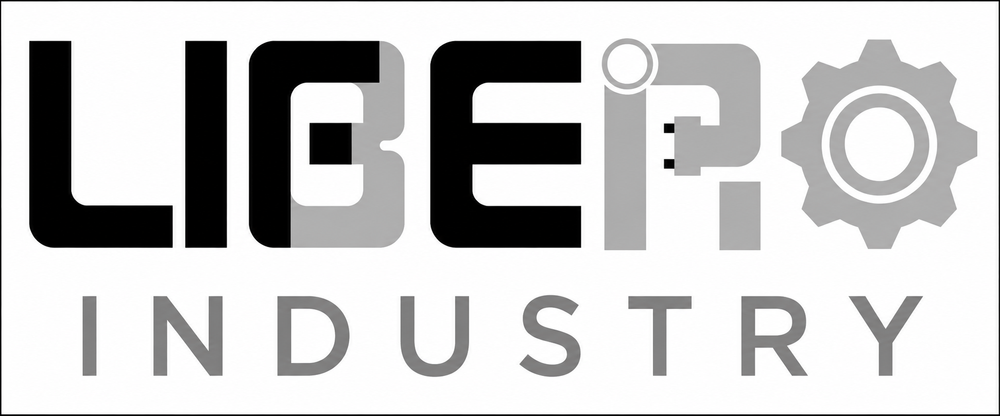
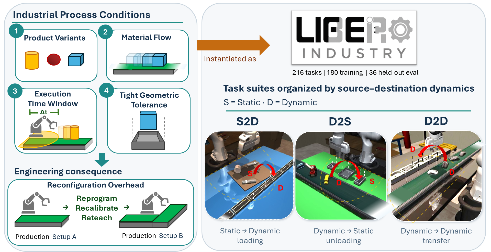

<p align="center">
  
</p>

<h1 align="center">LIBERO-Industry: Benchmarking Robotic Manipulation under Industrial Process Constraints</h1>

<p align="center">
Ming Shin Cindy Sung<sup>1</sup>, Duan Leijiahao<sup>1</sup>,
Haoxiang Wang<sup>1</sup>, Boning Tan<sup>1</sup>,
Liangna Fu<sup>1</sup>, Chao Tan<sup>1</sup>,
Yafu Li<sup>2</sup>, Yulong Chen<sup>3</sup>,
Chaoqun Wan<sup>1</sup>, Zhen Huang<sup>1</sup>,
Shuxian Liang<sup>1</sup>, Xian-Sheng Hua<sup>1</sup>
</p>

<p align="center">
<sup>1</sup>Tongji University
&nbsp;·&nbsp;
<sup>2</sup>The Chinese University of Hong Kong
&nbsp;·&nbsp;
<sup>3</sup>University of Cambridge
</p>

<p align="center">
  🌐 <a href="https://IAIE-PhysicalAI.github.io/LIBERO-Industry/"><strong>Project Page</strong></a>
  &nbsp;·&nbsp;
  📄 <a href="https://arxiv.org/abs/2610.16782"><strong>Paper</strong></a>
  &nbsp;·&nbsp;
  🗄️ <a href="https://huggingface.co/datasets/cindysung/LIBERO-industry-datasets"><strong>HDF5 Dataset</strong></a>
  &nbsp;·&nbsp;
  🤖 <a href="https://huggingface.co/datasets/cindysung/LIBERO-industry-lerobotv21-auboi5h"><strong>LeRobot v2.1 Dataset</strong></a>
</p>

---

<p align="center">
  
</p>

**Benchmark at a Glance**

| Item | Details |
| --- | --- |
| Benchmark | LIBERO-Industry |
| Task suites | S2D loading, D2S unloading, and D2D transfer |
| Difficulty | Three progressive levels |
| Task catalog | 216 tasks |
| Split | 180 training and 36 held-out evaluation tasks |
| Metrics | SR, PCR-T, and PCR-S |
| Simulation embodiment | Franka Panda |
| Deployment development | AUBO-i5H + CTAG2F90D; additional embodiments under development |

---


## 📑 Contents

- [Installation](#installation)
- [Datasets](#datasets)
- [Quick Start](#quick-start)
- [Evaluation](#evaluation)
- [Citation](#citation)
- [Acknowledgements](#acknowledgements)


## 🚀 Installation
We provide two runtime profiles to accommodate different simulator and embodiment requirements.

Clone the repository once before creating either environment:

On Windows, enable Git long-path support once before cloning. This changes
checkout handling only; it does not rename or rewrite BDDLs or initial states:

```powershell
git config --global core.longpaths true
```

```
git clone https://github.com/IAIE-PhysicalAI/LIBERO-Industry.git
cd LIBERO-industry
```

| Environment | Python | robosuite | Intended use |
| --- | --- | --- | --- |
| `libero-industry` | 3.8.13 | 1.4.0 | LIBERO-original and LIBERO-Industry simulation/evaluation with Franka Panda |
| `libero-deploy` | 3.10 | 1.5.2 | AUBO-i5H + CTAG2F90D collection/deployment |

### 1. Industry Version (Standard Evaluation)
Uses robosuite 1.4.0 for standard Franka Panda evaluation on LIBERO-original and LIBERO-Industry tasks.
```
conda create -n libero-industry python=3.8.13
conda activate libero-industry
pip install -r requirements-industry.txt
pip install torch==1.11.0+cu113 torchvision==0.12.0+cu113 torchaudio==0.11.0 --extra-index-url https://download.pytorch.org/whl/cu113
pip install -e .
```

### 2. Deploy Version (Multi-Embodiment Evaluation)
Uses robosuite 1.5.2 for AUBO-i5H + CTAG2F90D workflows.
```
conda create -n libero-deploy python=3.10 -y
conda activate libero-deploy
pip install -r requirements-deploy.txt
pip install torch torchvision torchaudio --index-url https://download.pytorch.org/whl/cu124
pip install -e .
```

## 📦 Datasets
You can download the dataset directly from HuggingFace:

- [🗄️ HDF5 Dataset](https://huggingface.co/datasets/cindysung/LIBERO-industry-datasets)
- [🤖 LeRobot v2.1 Dataset](https://huggingface.co/datasets/cindysung/LIBERO-industry-lerobotv21-auboi5h)

Bimanual benchmark support is under development on the `feature/multiembodiment-fixed-base` branch.

## ⚡ Quick Start

Select the benchmark split or task suite independently from the simulator embodiment.

| Purpose | Suite name |
| --- | --- |
| Training split | `libero_industry_train` |
| Held-out evaluation split | `libero_industry_test` |
| Suite-level analysis | `libero_industry_s2d`, `libero_industry_d2s`, or `libero_industry_d2d` |

```python
from libero.libero import benchmark

suite_name = "libero_industry_train"
embodiment = "panda"
task_id = 0

suite = benchmark.get_benchmark(suite_name)()
task = suite.get_task(task_id)
bddl_file = suite.get_task_bddl_file_path(task_id)
init_state = suite.get_task_init_states(
    task_id, embodiment=embodiment
)[0]

print(task.name)
print(task.language)
print(bddl_file)
print(init_state.shape)
```

Additional embodiments require a matching robot/gripper runtime and an embodiment-specific initial-state profile.

## 📊 Evaluation

The evaluation flow is almost identical to LIBERO. The main difference is that each LIBERO-Industry task automatically loads its task-specific runtime settings from [`libero/libero/benchmark/industry_env_args.json`](libero/libero/benchmark/industry_env_args.json). These settings define the rollout boundary (`takt_steps`), object-placement sampling mode, camera configuration—including agent-view orbit and camera offsets—lighting, and workbench color and finish.

The file maps each Industry task name to its environment settings and is applied when the environment is created from the task BDDL. For comparable results, do not override these task-specific settings. Use `libero_industry_train` for train-split diagnostics and `libero_industry_test` for official held-out evaluation, reporting SR, PCR-T, and PCR-S at the configured rollout boundary.

### Metrics

Each episode $m$ is evaluated at its predeclared task-specific rollout
boundary $K_{\mathrm{roll},m}$.

- **Success Rate (SR).** Episode success is one only when every required goal
  proposition is satisfied:
  $Y_m = \prod_{g \in G_m} E_m(g)$. We report
  $SR = \frac{1}{M}\sum_{m=1}^{M}Y_m$.
- **Target Partial Completion Rate (PCR-T).**
  $PCR_{T,m} = N_{\mathrm{transferred},m}/N_{\mathrm{target},m}$. This
  measures the fraction of target workpieces credited by the transfer
  predicate.
- **Slot Partial Completion Rate (PCR-S).**
  $PCR_{S,m} = N_{\mathrm{slotted},m}/(N_{\mathrm{target},m}+N_{\mathrm{base},m})$.
  This includes target workpieces and pre-existing destination workpieces that
  satisfy their terminal predicates. It therefore penalizes displacement of
  initially valid destination workpieces and should not be interpreted as newly
  completed transfers.

PCR-T and PCR-S are reported as episode means over the same $M$ episodes used
for SR. The official evaluation uses 36 held-out tasks and 10 deterministic
initial states per task, for 360 episodes per policy. At a task timeout, SR is
zero and both PCR values are computed from the terminal predicates at the
declared rollout boundary. Infrastructure failures must be recorded separately
and must not be silently dropped from reporting.

## 📄 Citation
If you find **LIBERO-Industry** useful in your research, please consider citing our paper:

```bibtex
@misc{sung2026liberoindustry,
  title={{LIBERO-Industry}: Benchmarking Robotic Manipulation under Industrial Process Constraints},
  author={Sung, Ming Shin Cindy and Duan, Leijiahao and Wang, Haoxiang and
          Tan, Boning and Fu, Liangna and Tan, Chao and Li, Yafu and
          Chen, Yulong and Wan, Chaoqun and Huang, Zhen and Liang, Shuxian and
          Hua, Xian-Sheng},
  year={2026},
  eprint={2610.16782},
  archivePrefix={arXiv},
  primaryClass={cs.AI},
  doi={10.48550/arXiv.2610.16782},
  url={https://arxiv.org/abs/2610.16782}
}
```

## 🙏 Acknowledgements

LIBERO-Industry is built on top of
[LIBERO](https://github.com/Lifelong-Robot-Learning/LIBERO), developed by Bo
Liu, Yifeng Zhu, Chongkai Gao, Yihao Feng, Qiang Liu, Yuke Zhu, and Peter
Stone. We thank the LIBERO authors for releasing the benchmark, codebase,
task-generation framework, and datasets. Users of this repository should cite
both LIBERO-Industry and the original LIBERO work.

```bibtex
@article{liu2023libero,
  title={LIBERO: Benchmarking Knowledge Transfer for Lifelong Robot Learning},
  author={Liu, Bo and Zhu, Yifeng and Gao, Chongkai and Feng, Yihao and
          Liu, Qiang and Zhu, Yuke and Stone, Peter},
  journal={arXiv preprint arXiv:2306.03310},
  year={2023}
}
```
